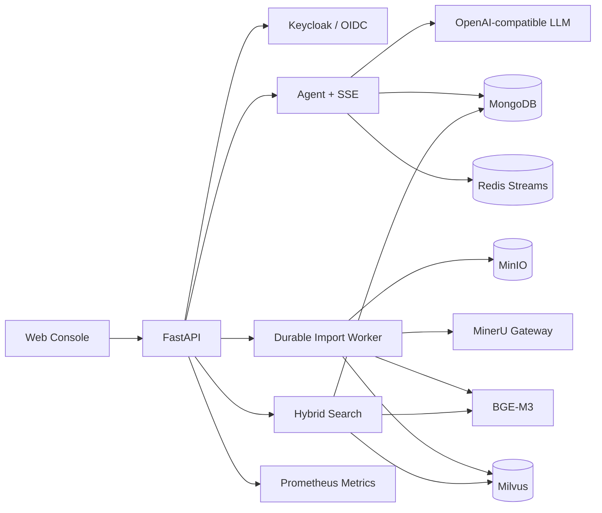

# Knowledge-Agent

[](https://www.python.org/)
[](https://fastapi.tiangolo.com/)
[](LICENSE)
[](#project-status)

**Production-oriented, multi-tenant RAG and knowledge agent platform.**

Knowledge-Agent turns private documents into a secure, searchable enterprise
knowledge base. It combines durable document ingestion, BGE-M3 hybrid
retrieval, citation-aware agent answers, OIDC login, tenant isolation,
observable infrastructure, and a unified web console.

[GitHub Repository](https://github.com/Fanxingwow/Knowledge-Agent) ·
[简体中文](README.zh-CN.md) · [Architecture](docs/architecture.md) ·
[Configuration](docs/configuration.md) · [Deployment](docs/deployment.md) ·
[Contributing](CONTRIBUTING.md)

> [!IMPORTANT]
> Knowledge-Agent is currently an alpha project. Its security controls are
> designed for real deployment, but API compatibility may change before 1.0.

## Why Knowledge-Agent?

Most RAG demos stop at “upload a PDF and ask a question.” Knowledge-Agent
focuses on the engineering work required after that demo:

- durable, idempotent and restart-safe imports;
- tenant- and owner-scoped data access;
- dense/sparse hybrid retrieval with authoritative visibility checks;
- OIDC Authorization Code + PKCE login through Keycloak;
- resumable SSE streams and persistent conversations;
- dependency readiness, Prometheus metrics and schema governance;
- automated security, quality and deployment contract gates.

## Features

- **Unified web console** — account login, chat, citations, conversation
  history, deletion, document upload and import progress.
- **Secure document ingestion** — private MinIO objects, upload limits,
  archive safety checks, idempotency keys, leased workers and retry recovery.
- **Hybrid RAG** — BGE-M3 dense and sparse embeddings, Milvus hybrid search,
  reranking, bounded concurrency and completed-import visibility filtering.
- **Agent answers** — OpenAI-compatible LLM integration, streamed responses
  and evidence-linked citations.
- **Multi-tenant isolation** — identity derived from signed JWT claims; MongoDB,
  Milvus, MinIO and Redis access is scoped by tenant and user ownership.
- **Enterprise identity** — Keycloak OIDC, PKCE, optional verified-email
  self-registration and per-user conversation isolation.
- **Operations** — liveness/readiness endpoints, protected Prometheus metrics,
  structured logs, Mongo/Milvus schema dry-runs and controlled migrations.
- **Quality gates** — pytest, Ruff, mypy, secret scanning, dependency review,
  Compose validation, Dockerfile checks and offline RAG evaluation.

## Architecture



The architecture and trust boundaries are documented in
[docs/architecture.md](docs/architecture.md).

## Quick start

### Prerequisites

- Docker Engine 24+ with Docker Compose v2
- 8 GB RAM for the base services
- 16 GB+ RAM and sufficient disk space when local BGE-M3 retrieval is enabled
- An OpenAI-compatible API key for agent answers
- A MinerU API token when document parsing is enabled

### 1. Prepare configuration

```bash
git clone https://github.com/Fanxingwow/Knowledge-Agent.git
cd Knowledge-Agent
cp deploy/compose.env.example deploy/compose.env
```

Replace every `change-me` value in `deploy/compose.env`. Never commit the real
file. At minimum, generate independent MongoDB, Redis, MinIO, metrics and
gateway secrets.

### 2. Validate and start

```bash
docker compose --env-file deploy/compose.env config --quiet
docker compose --env-file deploy/compose.env up -d --build
docker compose --env-file deploy/compose.env ps
```

### 3. Verify

```bash
curl http://127.0.0.1:8000/health/live
curl http://127.0.0.1:8000/health/ready
```

Open:

- Web console: <http://127.0.0.1:8000/console>
- OpenAPI: <http://127.0.0.1:8000/docs>
- MinIO console: <http://127.0.0.1:9001>

The default example keeps import and search disabled until a real BGE-M3 model
and MinerU credentials are configured. See
[docs/configuration.md](docs/configuration.md) to enable the complete RAG path.

## Server deployment: CPU or NVIDIA GPU

The default Linux image is intentionally CPU-only. The GPU overlay builds the
same application with an official CUDA-enabled PyTorch wheel and grants the
`api` container access to one NVIDIA GPU. This choice only affects local
BGE-M3 embedding and the optional local reranker; an external LLM API is not
accelerated by this setting.

| Mode | Recommended host | Compose files | Embedding settings |
| --- | --- | --- | --- |
| CPU | 4+ cores, 16 GB+ RAM | Base file only | `cpu`, FP32 |
| NVIDIA GPU | 8 GB+ VRAM, 16 GB+ RAM | Base file + `compose.gpu.yaml` | `cuda:0`, FP16 |

In both modes, place the complete `BAAI/bge-m3` directory at the path specified
by `BGE_M3_HOST_PATH`. Configure secrets and MinerU/LLM credentials in the
private env file before starting the stack.

### CPU deployment

For the self-contained stack:

```bash
cp deploy/compose.env.example deploy/compose.env
# Edit deploy/compose.env and keep BGE_DEVICE=cpu and BGE_FP16=false.

docker compose \
  --env-file deploy/compose.env \
  -f compose.yaml \
  config --quiet

docker compose \
  --env-file deploy/compose.env \
  -f compose.yaml \
  up -d --build
```

When the server already provides MinIO and Milvus, replace the env/base files:

```bash
cp deploy/server-reuse.env.example deploy/server-reuse.env

docker compose \
  --env-file deploy/server-reuse.env \
  -f compose.server-reuse.yaml \
  up -d --build
```

CPU mode is the compatibility default. Keep FP16 disabled on CPU; importing a
large manual can take significantly longer than on a GPU.

### NVIDIA GPU deployment

Install a compatible NVIDIA driver and the
[NVIDIA Container Toolkit](https://docs.nvidia.com/datacenter/cloud-native/container-toolkit/latest/install-guide.html),
then verify that Docker can see the GPU:

```bash
nvidia-smi
docker run --rm --gpus all \
  nvidia/cuda:12.9.0-base-ubuntu22.04 nvidia-smi
```

The overlay defaults to the PyTorch CUDA 13.0 (`cu130`) wheel. If the installed
driver or GPU requires the legacy CUDA 12.6 build, set
`PYTORCH_GPU_VARIANT=cu126` in the private env file. Supported build values are
`cu126`, `cu128` and `cu130`.

Start the self-contained GPU stack with both Compose files:

```bash
docker compose \
  --env-file deploy/compose.env \
  -f compose.yaml \
  -f compose.gpu.yaml \
  config --quiet

docker compose \
  --env-file deploy/compose.env \
  -f compose.yaml \
  -f compose.gpu.yaml \
  up -d --build
```

For a server that reuses existing MinIO and Milvus:

```bash
docker compose \
  --env-file deploy/server-reuse.env \
  -f compose.server-reuse.yaml \
  -f compose.gpu.yaml \
  up -d --build
```

Verify the installed PyTorch build and device access from inside the API
container:

```bash
docker compose \
  --env-file deploy/compose.env \
  -f compose.yaml \
  -f compose.gpu.yaml \
  exec -T api python -c \
  'import torch; print(torch.__version__); print(torch.cuda.get_device_name(0)); assert torch.cuda.is_available()'

curl -fsS http://127.0.0.1:8000/health/ready
```

Use the matching server-reuse file and port `8010` for the server-reuse mode.
The first GPU build is large because it downloads CUDA-enabled PyTorch wheels.
See [docs/deployment.md](docs/deployment.md) for operations and production
hardening.

## Local Python development

Knowledge-Agent uses [uv](https://docs.astral.sh/uv/) for deterministic Python
environments.

```bash
uv sync --frozen --group dev
cp .env.example .env
uv run uvicorn app.main:create_app --factory --host 127.0.0.1 --port 8000
```

Direct Python execution still requires the dependencies selected in `.env`.
Docker Compose is the recommended first-run path.

## Enabling the full RAG pipeline

1. Download `BAAI/bge-m3` outside Git and expose it through
   `BGE_M3_HOST_PATH`.
2. Configure a private MinIO bucket and a project-owned Milvus collection.
3. Configure the MinerU gateway and its upstream API token.
4. Set `IMPORT_ENABLED=true` and `SEARCH_ENABLED=true`.
5. Run the schema dry-run and apply the reviewed changes:

```bash
docker compose --env-file deploy/compose.env exec -T api \
  python scripts/schema_admin.py --target all

docker compose --env-file deploy/compose.env exec -T api \
  python scripts/schema_admin.py --target all --apply
```

For an existing server-side MinIO/Milvus installation, use
`compose.server-reuse.yaml` and follow [docs/deployment.md](docs/deployment.md).

## API overview

| Method | Endpoint | Purpose |
| --- | --- | --- |
| `GET` | `/health/live` | Process liveness |
| `GET` | `/health/ready` | Dependency readiness |
| `POST` | `/api/v1/imports` | Create idempotent document imports |
| `GET` | `/api/v1/imports/{task_id}` | Read import progress |
| `POST` | `/api/v1/search` | Tenant-safe hybrid retrieval |
| `POST` | `/api/v1/chat/sessions` | Create a conversation |
| `GET` | `/api/v1/chat/sessions` | List the current user's conversations |
| `POST` | `/api/v1/chat/sessions/{id}/messages` | Stream an agent answer |
| `DELETE` | `/api/v1/chat/sessions/{id}` | Delete an owned conversation |

See `/docs` for the complete generated API contract.

## Security model

- The client cannot choose `tenant_id` or `owner_subject`; both are derived
  from the verified authentication context.
- Object storage is private by default and uses tenant-scoped object keys.
- MongoDB queries include tenant and owner constraints.
- Milvus retrieval applies tenant filters and authoritative completed-import
  visibility checks.
- Redis stream keys are HMAC-derived and do not expose raw identity values.
- Secrets, model weights, uploaded documents and runtime data are excluded from
  source control and container build contexts.

Do not expose the development Compose stack directly to the internet. A public
deployment requires TLS, a reverse proxy, JWT authentication, rotated secrets,
backups and network controls. Report vulnerabilities according to
[SECURITY.md](SECURITY.md).

## Development

```bash
uv sync --frozen --group dev
uv run --frozen ruff check .
uv run --frozen mypy app eval scripts
uv run --frozen pytest -q
uv run --frozen python scripts/ci/check_secrets.py
```

Integration tests are opt-in and require explicitly configured external
services:

```bash
uv run pytest -m integration
```

## Project layout

```text
app/            API, domain services, gateways and infrastructure adapters
deploy/         Compose templates, Keycloak, MinIO and observability assets
docs/           Architecture, configuration and deployment documentation
eval/           Offline retrieval quality fixtures and evaluator
prompts/        Versioned agent and extraction prompts
scripts/        CI, schema administration and release tooling
tests/          Unit, API, evaluation and deployment contract tests
```

## Project status

Knowledge-Agent is under active development. The current focus is predictable
CPU/GPU inference behavior, non-blocking readiness probes, richer evaluation
datasets, pluggable parsers and production deployment references.

See [ROADMAP.md](ROADMAP.md) and [CHANGELOG.md](CHANGELOG.md).

## Contributing

Issues and pull requests are welcome. Read [CONTRIBUTING.md](CONTRIBUTING.md)
and the [Code of Conduct](CODE_OF_CONDUCT.md) before contributing.

## License

Licensed under the [Apache License 2.0](LICENSE).
