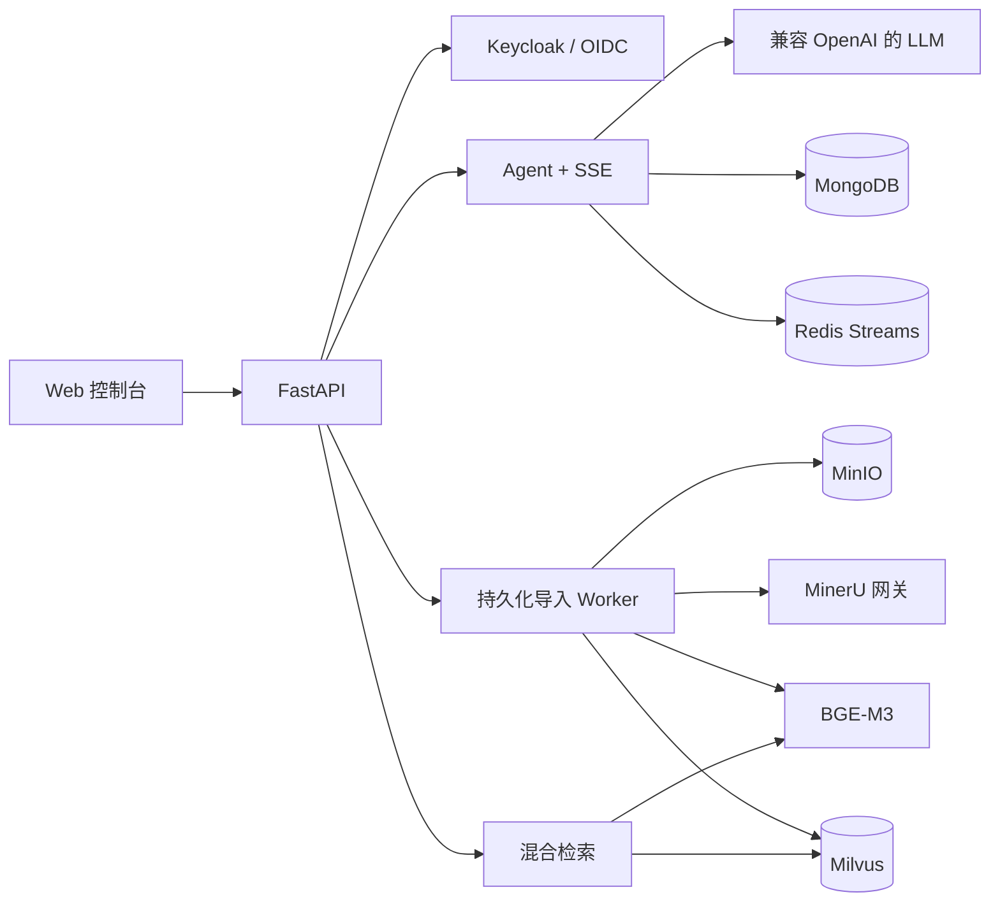

# Knowledge-Agent

**面向生产环境的多租户 RAG 与企业知识库 Agent 平台。**

Knowledge-Agent 将企业私有文档转化为可安全检索、可追溯引用的知识库，覆盖文档持久化导入、BGE-M3
混合检索、流式 Agent 回答、OIDC 登录、多租户隔离、可观测性与统一 Web 控制台。

[GitHub 仓库](https://github.com/Fanxingwow/Knowledge-Agent) ·
[English](README.md) · [架构](docs/architecture.md) ·
[配置](docs/configuration.md) · [部署](docs/deployment.md) ·
[参与贡献](CONTRIBUTING.md)

> **项目状态：Alpha。** 安全边界按照真实部署设计，但在 1.0 之前 API 仍可能调整。

## 核心能力

- **统一 Web 控制台**：账户登录、智能问答、引用来源、历史会话、会话删除、资料上传与导入进度。
- **可靠文档导入**：私有 MinIO 对象、大小限制、压缩包安全检查、幂等请求、租约 Worker、失败重试与重启恢复。
- **混合 RAG**：BGE-M3 稠密/稀疏向量、Milvus 混合召回、候选重排、已完成导入可见性校验。
- **Agent 回答**：兼容 OpenAI 协议的模型服务、SSE 流式输出和证据引用。
- **身份与隔离**：Keycloak OIDC + PKCE；身份从 JWT 派生，用户会话和问题相互隔离。
- **工程治理**：健康检查、Prometheus 指标、结构化日志、Mongo/Milvus Schema 预检与升级。
- **质量门禁**：pytest、Ruff、mypy、密钥扫描、依赖审查、Compose/Docker 契约和离线 RAG 评测。

## 架构概览



详细设计见 [docs/architecture.md](docs/architecture.md)。

## 快速开始

### 环境要求

- Docker Engine 24+ 与 Docker Compose v2
- 基础服务建议至少 8 GB 内存
- 启用本地 BGE-M3 时建议至少 16 GB 内存并预留足够磁盘空间
- Agent 回答需要兼容 OpenAI 协议的模型密钥
- 启用文档解析需要 MinerU Token

### 1. 准备配置

```bash
git clone https://github.com/Fanxingwow/Knowledge-Agent.git
cd Knowledge-Agent
cp deploy/compose.env.example deploy/compose.env
```

将 `deploy/compose.env` 中所有 `change-me` 替换为独立随机密钥。真实配置文件禁止提交到 Git。

### 2. 校验并启动

```bash
docker compose --env-file deploy/compose.env config --quiet
docker compose --env-file deploy/compose.env up -d --build
docker compose --env-file deploy/compose.env ps
```

### 3. 验证并访问

本节快速开始使用的是完整自建服务栈 `compose.yaml`，因此 API 默认端口是 `8000`：

```bash
curl http://127.0.0.1:8000/health/live
curl http://127.0.0.1:8000/health/ready
```

请根据实际启动的 Compose 模式选择访问地址：

| 服务 | 完整自建 `compose.yaml` | 服务器复用 `compose.server-reuse.yaml` |
| --- | --- | --- |
| Web 控制台 | <http://127.0.0.1:8000/console> | <http://127.0.0.1:8010/console> |
| OpenAPI | <http://127.0.0.1:8000/docs> | <http://127.0.0.1:8010/docs> |
| 存活检查 | <http://127.0.0.1:8000/health/live> | <http://127.0.0.1:8010/health/live> |
| 就绪检查 | <http://127.0.0.1:8000/health/ready> | <http://127.0.0.1:8010/health/ready> |
| Keycloak 管理后台 | 此模式不创建 | <http://127.0.0.1:8081/admin/> |
| MinIO 控制台 | <http://127.0.0.1:9001> | 使用服务器已有 MinIO 的控制台地址，本栈不创建 |
| 宿主机访问 Milvus gRPC | `127.0.0.1:19530` | 使用服务器已有 Milvus 的宿主机地址 |
| Milvus 健康检查 | <http://127.0.0.1:9091/healthz> | 使用服务器已有 Milvus 的健康检查地址 |
| Attu | 未内置 | 未内置；使用单独部署的 Attu 地址 |

服务器复用模式特意使用 `8010`，因为服务器上已有的 Attu 可能已经占用 `8000`。该模式的 API
和 Keycloak 默认只绑定 `127.0.0.1`；从个人电脑访问时需要建立 SSH 隧道，生产环境则应使用
HTTPS 反向代理。

### Milvus 连接地址

Milvus 本身不提供浏览器管理页面，本项目也没有内置 Attu。请根据访问方选择地址：

| 部署方式/访问方 | Milvus 地址 | 用途 |
| --- | --- | --- |
| 完整 Compose 栈中的 API 容器 | `http://milvus:19530` | 应用内部连接，Compose 已自动配置 |
| 完整 Compose 栈所在服务器 | `127.0.0.1:19530` | `pymilvus`、SDK 或服务器本地管理工具 |
| 完整 Compose 栈健康检查 | `http://127.0.0.1:9091/healthz` | 检查 Milvus 进程状态 |
| 服务器复用模式中的 API 容器 | `http://host.docker.internal:19530` | Milvus 运行在 Docker 宿主机时的默认 `MILVUS_URL` |

完整服务栈默认通过 `MILVUS_BIND_ADDRESS=127.0.0.1` 将 `19530` 和 `9091` 端口只绑定到
服务器回环地址，因此其他电脑不能直接访问，生产环境也建议保持私有。服务器复用模式需要在
`deploy/server-reuse.env` 中设置 `MILVUS_URL`，该地址必须能从 **API 容器内部**访问；不要填写
`127.0.0.1`，否则它指向的是 API 容器自身，而不是宿主机上的 Milvus。

示例配置默认不启用导入和检索。配置真实 BGE-M3 模型与 MinerU 后，将
`IMPORT_ENABLED` 和 `SEARCH_ENABLED` 改为 `true`。完整说明见
[docs/configuration.md](docs/configuration.md)。

## 服务器部署：CPU 与 NVIDIA GPU

Linux 默认镜像是 CPU 版本。GPU 覆盖文件会在同一个应用镜像中换装官方 CUDA 版 PyTorch，
并为 `api` 容器分配一张 NVIDIA GPU。该选择只加速本地 BGE-M3 向量化和可选的本地重排器；
如果 LLM 使用外部 API，则不会因为启用 GPU 而改变。

| 模式 | 建议服务器配置 | Compose 文件 | 向量模型配置 |
| --- | --- | --- | --- |
| CPU | 4 核以上、16 GB 以上内存 | 仅基础 Compose | `cpu`、FP32 |
| NVIDIA GPU | 8 GB 以上显存、16 GB 以上内存 | 基础 Compose + `compose.gpu.yaml` | `cuda:0`、FP16 |

两种模式都需要把完整的 `BAAI/bge-m3` 模型目录放到 `BGE_M3_HOST_PATH` 指定的位置，并先在
私有环境文件中配置随机密钥、MinerU Token 和 LLM 密钥。真实环境文件不得提交到 Git。

### CPU 版本部署

部署包含 MongoDB、Redis、MinIO 和 Milvus 的完整服务栈：

```bash
cp deploy/compose.env.example deploy/compose.env
# 编辑 deploy/compose.env，并保持 BGE_DEVICE=cpu、BGE_FP16=false。

docker compose \
  --env-file deploy/compose.env \
  -f compose.yaml \
  config --quiet

docker compose \
  --env-file deploy/compose.env \
  -f compose.yaml \
  up -d --build
```

如果服务器已经运行 MinIO 和 Milvus，则使用复用模式：

```bash
cp deploy/server-reuse.env.example deploy/server-reuse.env

docker compose \
  --env-file deploy/server-reuse.env \
  -f compose.server-reuse.yaml \
  up -d --build

curl -fsS http://127.0.0.1:8010/health/ready
```

CPU 是兼容性最好的默认模式。CPU 环境不要启用 FP16；大型 PDF 手册的向量化可能需要较长时间。

### NVIDIA GPU 版本部署

服务器需要安装兼容的 NVIDIA 驱动和
[NVIDIA Container Toolkit](https://docs.nvidia.com/datacenter/cloud-native/container-toolkit/latest/install-guide.html)，
先确认宿主机和 Docker 都可以识别 GPU：

```bash
nvidia-smi
docker run --rm --gpus all \
  nvidia/cuda:12.9.0-base-ubuntu22.04 nvidia-smi
```

GPU 覆盖文件默认安装 PyTorch CUDA 13.0（`cu130`）版本。如果服务器驱动或旧型号 GPU 需要
CUDA 12.6，请在私有环境文件中设置 `PYTORCH_GPU_VARIANT=cu126`。目前支持 `cu126`、
`cu128` 和 `cu130`。

完整服务栈的 GPU 启动命令：

```bash
docker compose \
  --env-file deploy/compose.env \
  -f compose.yaml \
  -f compose.gpu.yaml \
  config --quiet

docker compose \
  --env-file deploy/compose.env \
  -f compose.yaml \
  -f compose.gpu.yaml \
  up -d --build
```

复用服务器已有 MinIO 和 Milvus 时：

```bash
docker compose \
  --env-file deploy/server-reuse.env \
  -f compose.server-reuse.yaml \
  -f compose.gpu.yaml \
  up -d --build
```

进入 API 容器验证 CUDA 版 PyTorch 和 GPU：

```bash
docker compose \
  --env-file deploy/compose.env \
  -f compose.yaml \
  -f compose.gpu.yaml \
  exec -T api python -c \
  'import torch; print(torch.__version__); print(torch.cuda.get_device_name(0)); assert torch.cuda.is_available()'

curl -fsS http://127.0.0.1:8000/health/ready
# 使用 compose.server-reuse.yaml 时改为 8010：
curl -fsS http://127.0.0.1:8010/health/ready
```

服务器复用模式请把基础文件替换为 `compose.server-reuse.yaml`，健康检查端口使用 `8010`。
GPU 第一次构建需要下载较大的 CUDA 版 PyTorch 依赖，耗时明显长于增量构建。生产加固和运维说明见
[docs/deployment.md](docs/deployment.md)。

## 开启完整 RAG 链路

1. 在 Git 仓库外下载 `BAAI/bge-m3`，通过 `BGE_M3_HOST_PATH` 挂载。
2. 创建不允许匿名访问的 MinIO 私有桶。
3. 配置项目专属的 Milvus collection。
4. 配置 MinerU 网关与上游 Token。
5. 执行 Schema 预检并人工确认变更：

```bash
docker compose --env-file deploy/compose.env exec -T api \
  python scripts/schema_admin.py --target all

docker compose --env-file deploy/compose.env exec -T api \
  python scripts/schema_admin.py --target all --apply
```

复用服务器已有 MinIO/Milvus 时，使用 `compose.server-reuse.yaml`，具体见
[docs/deployment.md](docs/deployment.md)。

## 本地开发

```bash
uv sync --frozen --group dev
cp .env.example .env
uv run uvicorn app.main:create_app --factory --host 127.0.0.1 --port 8000
```

质量检查：

```bash
uv run --frozen ruff check .
uv run --frozen mypy app eval scripts
uv run --frozen pytest -q
uv run --frozen python scripts/ci/check_secrets.py
```

## 安全说明

- 客户端不能自行指定租户或用户身份，必须从已验证 JWT 中派生。
- MinIO、MongoDB、Milvus 与 Redis 均使用租户/用户作用域。
- `.env`、模型权重、上传文档、数据库文件、日志和部署压缩包均被排除在 Git 之外。
- 开发 Compose 不应直接暴露公网；公开部署必须配置 TLS、反向代理、JWT、备份和网络访问控制。

安全问题请按照 [SECURITY.md](SECURITY.md) 私下报告，不要直接创建公开 Issue。

## 参与贡献与许可证

欢迎提交 Issue 和 Pull Request。请先阅读 [CONTRIBUTING.md](CONTRIBUTING.md)
与 [CODE_OF_CONDUCT.md](CODE_OF_CONDUCT.md)。

本项目使用 [Apache License 2.0](LICENSE)。
