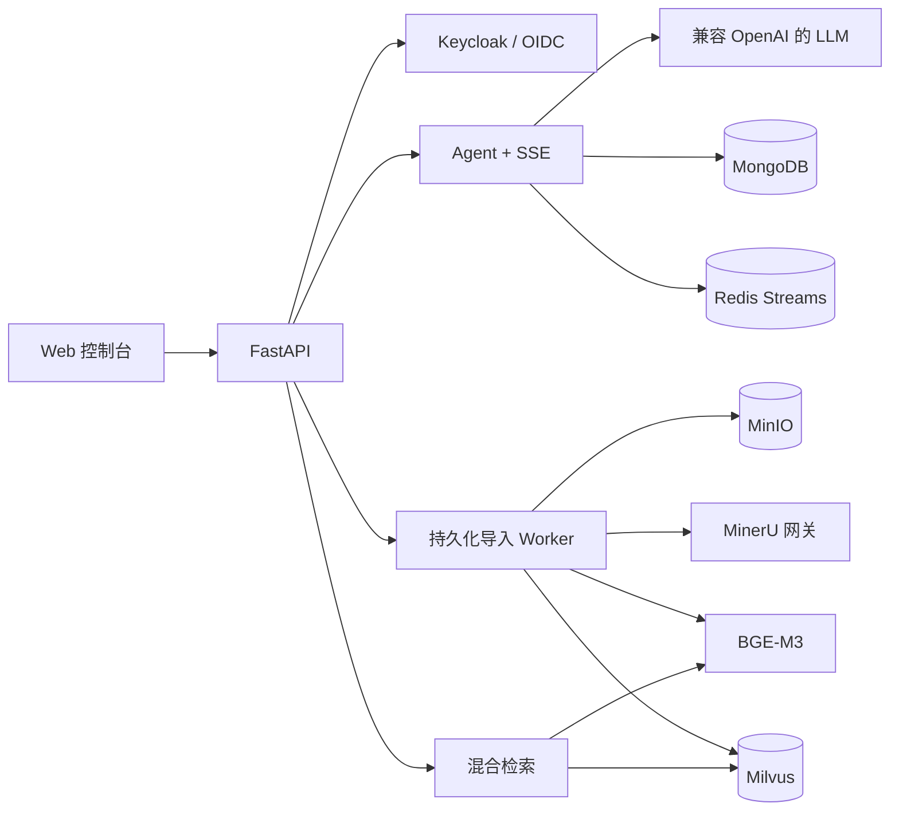

# Knowledge-Agent

**面向生产环境的多租户 RAG 与企业知识库 Agent 平台。**

Knowledge-Agent 将企业私有文档转化为可安全检索、可追溯引用的知识库，覆盖文档持久化导入、BGE-M3
混合检索、流式 Agent 回答、OIDC 登录、多租户隔离、可观测性与统一 Web 控制台。

[English](README.md) · [架构](docs/architecture.md) ·
[配置](docs/configuration.md) · [部署](docs/deployment.md) ·
[参与贡献](CONTRIBUTING.md)

> **项目状态：Alpha。** 安全边界按照真实部署设计，但在 1.0 之前 API 仍可能调整。

## 核心能力

- **统一 Web 控制台**：账户登录、智能问答、引用来源、历史会话、会话删除、资料上传与导入进度。
- **可靠文档导入**：私有 MinIO 对象、大小限制、压缩包安全检查、幂等请求、租约 Worker、失败重试与重启恢复。
- **混合 RAG**：BGE-M3 稠密/稀疏向量、Milvus 混合召回、候选重排、已完成导入可见性校验。
- **Agent 回答**：兼容 OpenAI 协议的模型服务、SSE 流式输出和证据引用。
- **身份与隔离**：Keycloak OIDC + PKCE；身份从 JWT 派生，用户会话和问题相互隔离。
- **工程治理**：健康检查、Prometheus 指标、结构化日志、Mongo/Milvus Schema 预检与升级。
- **质量门禁**：pytest、Ruff、mypy、密钥扫描、依赖审查、Compose/Docker 契约和离线 RAG 评测。

## 架构概览



详细设计见 [docs/architecture.md](docs/architecture.md)。

## 快速开始

### 环境要求

- Docker Engine 24+ 与 Docker Compose v2
- 基础服务建议至少 8 GB 内存
- 启用本地 BGE-M3 时建议至少 16 GB 内存并预留足够磁盘空间
- Agent 回答需要兼容 OpenAI 协议的模型密钥
- 启用文档解析需要 MinerU Token

### 1. 准备配置

```bash
git clone <你的仓库或 Fork 地址>
cd Knowledge-Agent
cp deploy/compose.env.example deploy/compose.env
```

将 `deploy/compose.env` 中所有 `change-me` 替换为独立随机密钥。真实配置文件禁止提交到 Git。

### 2. 校验并启动

```bash
docker compose --env-file deploy/compose.env config --quiet
docker compose --env-file deploy/compose.env up -d --build
docker compose --env-file deploy/compose.env ps
```

### 3. 验证并访问

```bash
curl http://127.0.0.1:8000/health/live
curl http://127.0.0.1:8000/health/ready
```

- Web 控制台：<http://127.0.0.1:8000/console>
- OpenAPI：<http://127.0.0.1:8000/docs>
- MinIO 控制台：<http://127.0.0.1:9001>

示例配置默认不启用导入和检索。配置真实 BGE-M3 模型与 MinerU 后，将
`IMPORT_ENABLED` 和 `SEARCH_ENABLED` 改为 `true`。完整说明见
[docs/configuration.md](docs/configuration.md)。

## 开启完整 RAG 链路

1. 在 Git 仓库外下载 `BAAI/bge-m3`，通过 `BGE_M3_HOST_PATH` 挂载。
2. 创建不允许匿名访问的 MinIO 私有桶。
3. 配置项目专属的 Milvus collection。
4. 配置 MinerU 网关与上游 Token。
5. 执行 Schema 预检并人工确认变更：

```bash
docker compose --env-file deploy/compose.env exec -T api \
  python scripts/schema_admin.py --target all

docker compose --env-file deploy/compose.env exec -T api \
  python scripts/schema_admin.py --target all --apply
```

复用服务器已有 MinIO/Milvus 时，使用 `compose.server-reuse.yaml`，具体见
[docs/deployment.md](docs/deployment.md)。

## 本地开发

```bash
uv sync --frozen --group dev
cp .env.example .env
uv run uvicorn app.main:create_app --factory --host 127.0.0.1 --port 8000
```

质量检查：

```bash
uv run --frozen ruff check .
uv run --frozen mypy app eval scripts
uv run --frozen pytest -q
uv run --frozen python scripts/ci/check_secrets.py
```

## 安全说明

- 客户端不能自行指定租户或用户身份，必须从已验证 JWT 中派生。
- MinIO、MongoDB、Milvus 与 Redis 均使用租户/用户作用域。
- `.env`、模型权重、上传文档、数据库文件、日志和部署压缩包均被排除在 Git 之外。
- 开发 Compose 不应直接暴露公网；公开部署必须配置 TLS、反向代理、JWT、备份和网络访问控制。

安全问题请按照 [SECURITY.md](SECURITY.md) 私下报告，不要直接创建公开 Issue。

## 参与贡献与许可证

欢迎提交 Issue 和 Pull Request。请先阅读 [CONTRIBUTING.md](CONTRIBUTING.md)
与 [CODE_OF_CONDUCT.md](CODE_OF_CONDUCT.md)。

本项目使用 [Apache License 2.0](LICENSE)。
